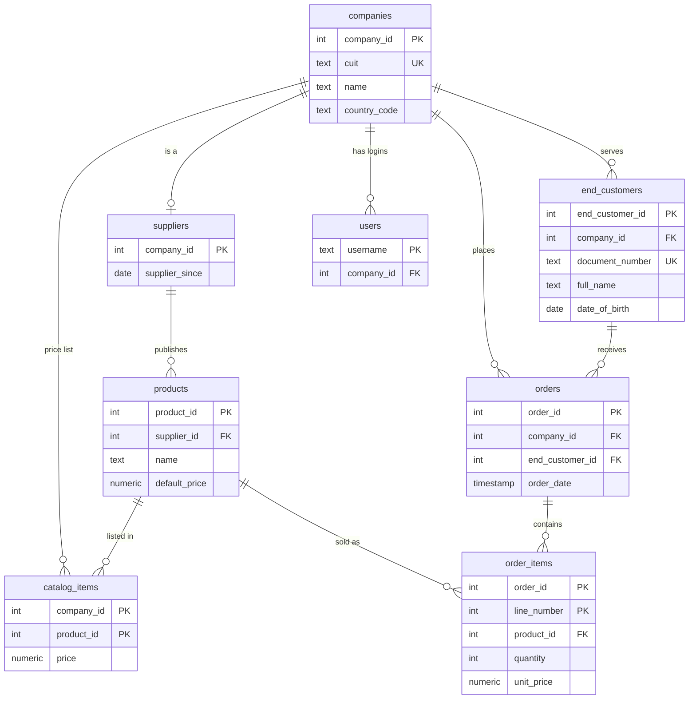
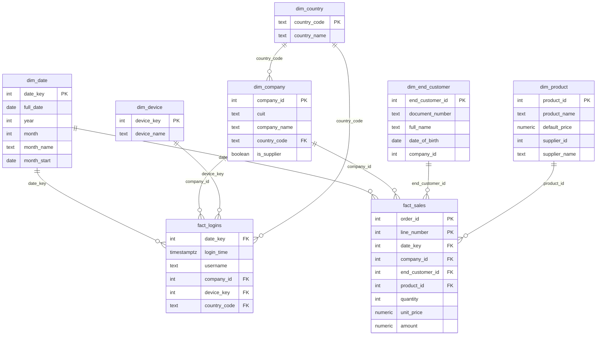

# Entity relationship diagrams

Two diagrams: the source database the data comes from, and the warehouse it is loaded into.

How to view them: GitHub draws them automatically. In VS Code, install the extension
"Markdown Preview Mermaid Support" and open the Markdown preview. Or paste a diagram into
https://mermaid.live to export it as PNG or SVG.

## Source: B2B platform (database `b2b_source`, schema `b2b`)

Defined in `sources/postgres/schema.sql`.

## Warehouse: star schema (databases `b2b_warehouse_dev` and `b2b_warehouse_prod`, schema `dw`)

Defined in `sql/dimensions/` and `sql/facts/`. Two fact tables in the middle, six dimensions around them.

The lines in the warehouse diagram are logical links. The `dw` tables have primary keys but no
foreign-key constraints; `dq/referential_integrity.sql` checks on every run that each fact row points to
a dimension row that exists.
